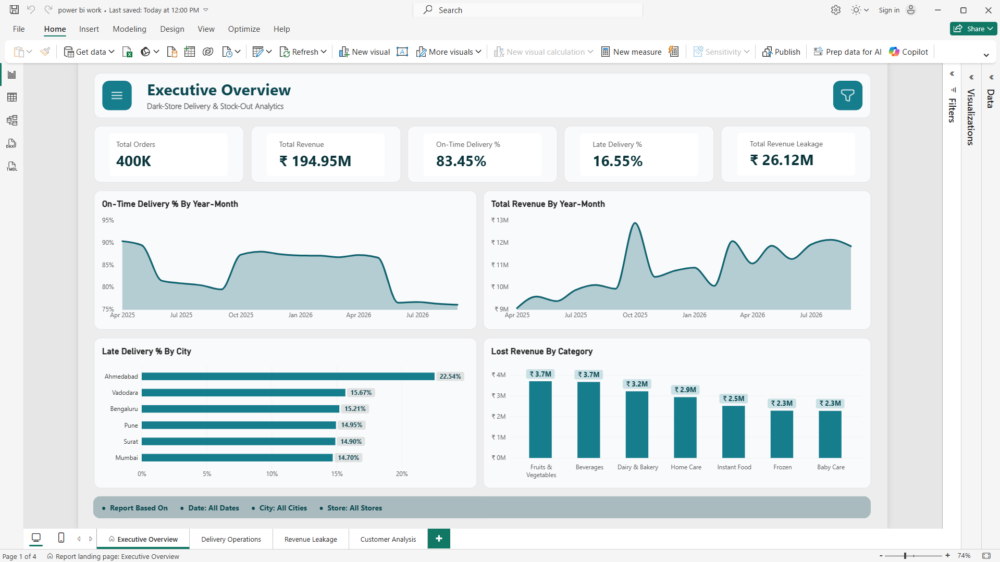
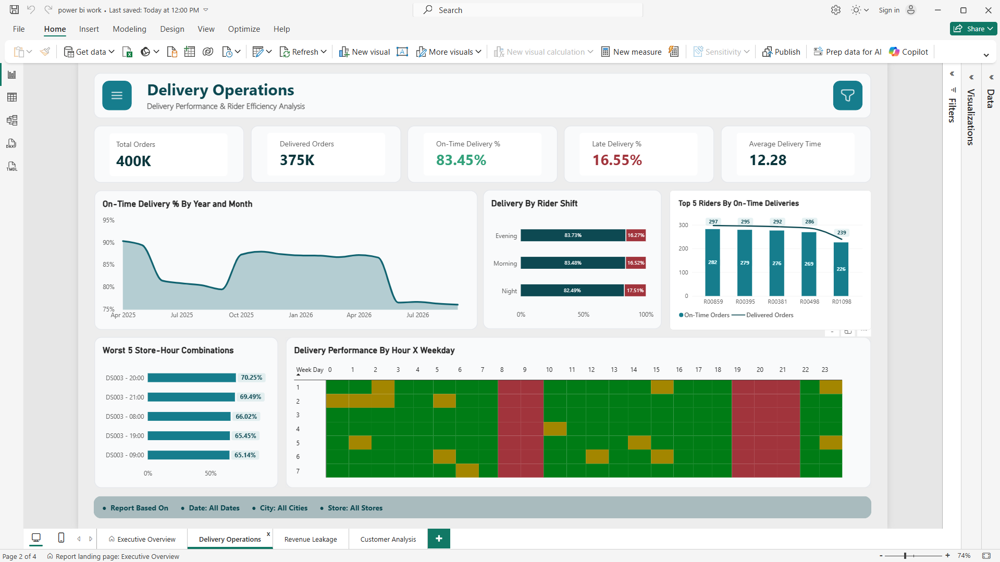
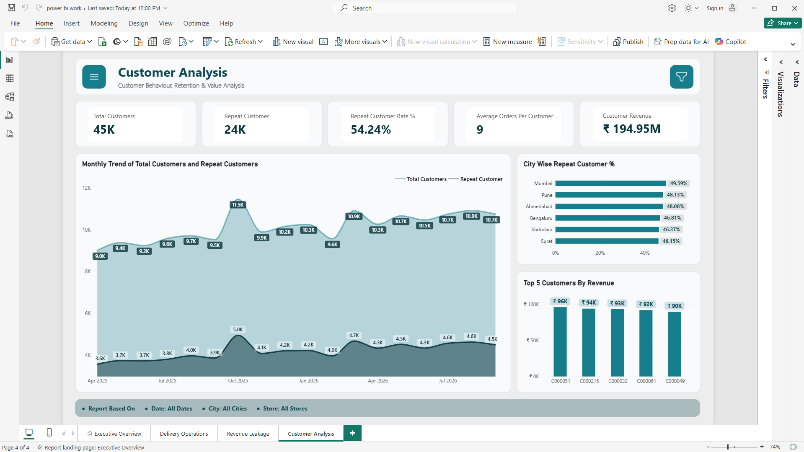

# QuickKart — Dark-Store Delivery & Analytics

A multi-tool data analytics project exploring dark-store operations, delivery performance, revenue leakage, and customer behaviour. The project brings together **Excel, SQL, Python, and Power BI** for data preparation, analysis, and business reporting.


---

## 1. Project Overview

QuickKart is a dark-store delivery analytics project built to examine operational data and turn it into useful business reporting.

The repository contains work across four tools:

- **Excel:** Spreadsheet-based data work and analysis.
- **SQL:** Query-based data analysis.
- **Python:** Data loading, cleaning, validation, and preparation.
- **Power BI:** Interactive dashboards for business and operational analysis.

The Power BI report contains four dashboard pages:

1. Executive Overview
2. Delivery Performance
3. Revenue Leakage
4. Customer Analysis

## 2. Problem Statement

Dark-store delivery operations depend on accurate order information, reliable inventory records, efficient fulfilment, and timely deliveries. Inconsistent formats, duplicate records, invalid timestamps, and unusable order items can make operational reporting unreliable.

This project uses data preparation and analysis workflows to improve the usability of the supplied datasets and present operational information through dashboards.

## 3. Dataset Description

**Dataset file:** `QuickKart_DarkStore_Dataset.zip`  
**Number of CSV tables:** 6  
**Total original records:** **2,444,185**

The row counts below are the supplied counts for the original CSV tables.

| CSV table | Rows | Columns |
|---|---:|---|
| `order_items.csv` | 1,163,045 | `order_id`, `sku_id`, `qty`, `mrp`, `discount_pct`, `fulfilled_flag` |
| `daily_stock_snapshot.csv` | 876,800 | `snapshot_date`, `store_id`, `sku_id`, `closing_qty`, `received_qty` |
| `orders.csv` | 400,600 | `order_id`, `customer_id`, `store_id`, `order_ts`, `rider_id`, `delivered_ts`, `promised_mins`, `status`, `payment_mode` |
| `products.csv` | 2,500 | `sku_id`, `sku_name`, `category`, `sub_category`, `brand`, `mrp`, `shelf_life_days` |
| `riders.csv` | 1,200 | `rider_id`, `store_id`, `join_date`, `shift`, `vehicle_type` |
| `stores.csv` | 40 | `store_id`, `city`, `zone`, `opening_date`, `parent_hub_id` |
| **Total** | **2,444,185** | **6 tables** |

### Dataset notes

- The total is the sum of the row counts across all six source tables. It is not a count of unique orders or customers.
- The dataset archive is named `QuickKart_DarkStore_Dataset.zip`.
- The original publisher, licensing terms, and whether the records are synthetic or real-world have not been established in this README. Verify those details before describing the dataset as real-world or redistributing it.

## 4. Tools & Technologies

| Tool / Technology | Role in the project |
|---|---|
| Microsoft Excel | Spreadsheet-based analysis |
| SQL | Query-based data analysis |
| Python | Data cleaning, validation, and preparation |
| Pandas | Tabular data manipulation |
| NumPy | Numerical operations |
| Matplotlib | Data visualization |
| Seaborn | Statistical visualization |
| Plotly | Data visualization |
| Jupyter Notebook | Python workflow and documentation |
| Power BI | Interactive dashboards and reporting |
| Git & GitHub | Version control and project hosting |

## 5. Project Workflow

### Step 1 — Data loading

- Load the six CSV tables using Python and Pandas.
- Check that the expected columns are present.
- Load each table into a separate DataFrame for processing.

### Step 2 — Data cleaning and standardization

- Remove completely duplicated records.
- Trim leading and trailing whitespace from text values.
- Standardize text values to uppercase.
- Convert blank strings and common missing-value representations such as `NA` and `N/A` to null values.
- Convert date and timestamp fields to datetime values.
- Convert numeric fields to numeric data types.

### Step 3 — Order and item validation

The documented validation rules include:

- Identify orders where `delivered_ts` is earlier than `order_ts`.
- Resolve duplicate `order_id` values using the notebook's record-selection rule.
- Remove order-item rows where `qty` is zero.
- Identify orders whose remaining item quantities sum to zero.
- Validate item `sku_id` values against the configured SKU range.

### Step 4 — Invalid record handling

- Remove orders with delivery timestamps earlier than their order timestamps.
- For duplicate order IDs, retain the record with fewer missing values in `payment_mode` and `delivered_ts`.
- Remove order-item rows with zero quantity.
- Remove orders whose total item quantity is zero.
- Remove order-item records associated with invalid orders.
- Remove item records outside the configured SKU range.

### Step 5 — Export cleaned data

- Export the processed tables as CSV files.
- Keep processed files separate from original source data in `cleaned_dataset/`.
- Use the cleaned tables as the data source for Power BI.

### Step 6 — Analysis and reporting

- Use the Excel workbook and SQL script in `Excel & SQL/` for the project's spreadsheet and query work.
- Load the prepared data into Power BI.
- Create data relationships and report measures.
- Build the four dashboard pages.
- Use report filters and navigation to explore the data.

## 6. Data Cleaning Rules

The following rules are documented in the Python cleaning workflow.

| Area | Rule / transformation |
|---|---|
| Schema validation | Check that required columns exist before processing a table |
| Text cleaning | Trim leading and trailing whitespace |
| Text standardization | Convert text values to uppercase |
| Missing values | Normalize blank strings and common markers such as `NA` and `N/A` to null |
| Data types | Convert date/time and numeric columns to appropriate types |
| Exact duplicates | Remove completely duplicated rows |
| Duplicate orders | Retain the duplicate `order_id` record with fewer missing values in `payment_mode` and `delivered_ts` |
| Invalid timestamps | Remove orders where `delivered_ts` is earlier than `order_ts` |
| Zero-quantity items | Remove rows where `qty = 0` |
| Zero-total-quantity orders | Remove orders whose item quantities sum to zero |
| Invalid SKU values | Remove item rows outside the configured SKU range |

### Validation details

- The notebook's configured SKU cutoff is `SKU02500`. Confirm that this project-specific rule matches the intended dataset rules.
- The duplicate-order selection rule compares missing values in `payment_mode` and `delivered_ts`. It does not assess every column when choosing which duplicate record to keep.
- The zero-total-quantity check is based on the sum of item quantities. It is not simply a check for whether an order has any item rows.
- Verified final row counts for the cleaned tables have not been provided, so this README does not invent them.

## 7. Power BI Dashboard Showcase

The report contains four dashboard pages. The screenshots below use the existing repository image locations.

### 7.1 Executive Overview



Provides a high-level overview of the business metrics presented in the report.

### 7.2 Delivery Performance



Focuses on delivery performance and operational efficiency.

### 7.3 Revenue Leakage


Presents the revenue-leakage analysis included in the Power BI report.

### 7.4 Customer Analysis



Presents customer-related analysis using the available order and customer fields.

> Dashboard-specific KPIs, numerical findings, and detailed conclusions should be documented only after checking the finished report pages. They are not invented here.

## 8. Key Insights & Findings

Add the final findings from the completed dashboards in this section. Include the metric, its value, the relevant time period or comparison, and what it means for the business.

- **Executive Overview:** Add the most important overall business finding.
- **Delivery Performance:** Add a verified delivery-time or on-time-performance finding.
- **Revenue Leakage:** Add a verified revenue-leakage finding and its calculation basis.
- **Customer Analysis:** Add a verified customer behaviour or purchasing-pattern finding.

No numerical insights are included yet because the dashboard values were not supplied with the README text.


## 9. How to Run the Project

Follow these simple steps to run the project on your computer.

### Requirements

Before starting, install:

- [Python](https://www.python.org/downloads/)
- [Jupyter Notebook](https://jupyter.org/install)
- [Microsoft Power BI Desktop](https://www.microsoft.com/power-platform/products/power-bi/desktop)
- Microsoft Excel
- A SQL client compatible with the SQL script

### Step 1 — Download the Project

Clone the repository:

```bash
git clone https://github.com/darshanDR11/QuickKart-Dark-Store-Analytics.git
```

Open the downloaded project folder.

Alternatively, download the repository as a ZIP file from GitHub and extract it.

### Step 2 — Prepare the Dataset

1. Extract `QuickKart_DarkStore_Dataset.zip`.
2. Copy the six CSV files into the `dataset/` folder.
3. Keep the original CSV files inside `dataset/`.
4. The cleaned CSV files will be stored in `cleaned_dataset/` after running the Python notebook.

### Step 3 — Install Python Libraries

Open a terminal in the project folder and run:

```bash
pip install pandas numpy matplotlib seaborn plotly jupyter
```

### Step 4 — Run the Python Notebook

1. Open a terminal in the project folder.
2. Start Jupyter Notebook:

```bash
jupyter notebook
```

3. Open the `Python/` folder.
4. Open `Python Work.ipynb`.
5. Run the notebook cells from top to bottom.

**Note:** Make sure the dataset paths in the notebook point to the `dataset/` folder and the output paths point to `cleaned_dataset/`.

### Step 5 — Explore Excel and SQL Analysis

- Open `Excel & SQL/Excel Work.xlsx` using Microsoft Excel.
- Open `Excel & SQL/SQL Work.sql` using your SQL client.
- Configure the database connection and execute the SQL queries as required.

### Step 6 — Open the Power BI Dashboard

1. Open Microsoft Power BI Desktop.
2. Open `work/Power BI Work.pbix`.
3. If the data source paths are not recognized, update them in **Transform Data → Data Source Settings** or Power Query.
4. Set the paths to the CSV files in `cleaned_dataset/`.
5. Click **Refresh** to load the data.
6. Explore all four dashboard pages.

### Project Execution Flow

```text
Download Project
       ↓
Prepare Original Dataset
       ↓
Run Python Notebook
       ↓
Generate Cleaned CSV Files
       ↓
Explore Excel & SQL Analysis
       ↓
Open Power BI Report
       ↓
Refresh Data & Explore Dashboards
```


## 10. Repository Structure

```text
QuickKart-Dark-Store-Analytics/
│
├── Excel & SQL/
│   ├── Excel Work.xlsx
│   └── SQL Work.sql
│
├── Python/
│   └── Python Work.ipynb
│
├── cleaned_dataset/
│
├── dataset/
│
├── images/
│   ├── dashboard/
│   │   ├── 01-Executive-Overview.png
│   │   ├── 02-Delivery-Performance.png
│   │   ├── 03-Revenue-Leakage.png
│   │   └── 04-Customer-Analysis.png
│   │
│   └── icon/
│       ├── filter.svg
│       └── hamburger.svg
│
└── work/
    └── Power BI Work.pbix
```

## 11. Future Improvements

- Automate the data cleaning and refresh workflow.
- Generate a repeatable data-quality report for each source table.
- Add validation logs so rejected records and reasons can be reviewed.
- Add more detailed inventory and stock-out analysis.
- Extend customer segmentation and purchasing-pattern analysis.
- Evaluate forecasting or anomaly-detection methods where suitable data and evaluation criteria are available.
- Optimize the Power BI data model and report performance.

## 12. Contact

**Darshan Dudhat**

- GitHub: [github.com/darshanDR11](https://github.com/darshanDR11)

---

If you find an issue or have a suggestion, feel free to open an issue in the repository.
"""
