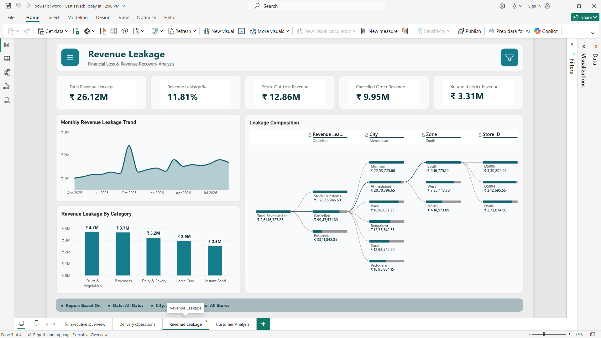

# QuickKart — Dark-Store Delivery & Stock-Out Analytics


A multi-tool analytics project focused on dark-store operations, last-mile delivery performance, revenue leakage, and customer behaviour. The project combines Python, SQL, Excel, and Power BI to transform raw operational data into actionable business insights for operations, finance, and customer strategy teams.

## Table of Contents

- [1. Project Overview](#1-project-overview)
- [2. Problem Statement](#2-problem-statement)
- [3. Objectives and Scope](#3-objectives-and-scope)
- [4. Dataset Description](#4-dataset-description)
- [5. Tools & Technologies](#5-tools--technologies)
- [6. Power BI Dashboard Showcase](#6-power-bi-dashboard-showcase)
- [7. Power BI Key Insights](#7-power-bi-key-insights)
- [8. Supporting Work](#8-supporting-work)
- [9. Data Cleaning & Processing](#9-data-cleaning--processing)
- [10. Project Workflow](#10-project-workflow)
- [11. Project Structure](#11-project-structure)
- [12. How to Run the Project](#12-how-to-run-the-project)
- [13. Future Improvements](#13-future-improvements)
- [14. Contact](#14-contact)

---

## 1. Project Overview

QuickKart is a dark-store delivery analytics project designed to examine operational performance and turn it into useful business reporting.

The repository contains work across four tools:

- Excel for spreadsheet-based analysis
- SQL for query-based analysis
- Python for data loading, cleaning, validation, and preparation
- Power BI for interactive dashboards and business reporting

The Power BI report contains four dashboard pages:

1. Executive Overview
2. Delivery Performance
3. Revenue Leakage
4. Customer Analysis

This project helps answer core business questions around service reliability, delivery efficiency, lost revenue, and customer retention in a high-volume dark-store environment.

---

## 2. Problem Statement

Dark-store delivery operations depend on accurate order information, reliable inventory records, efficient fulfilment, and timely deliveries. Inconsistent formats, duplicate records, invalid timestamps, zero-quantity items, and stock-out scenarios can distort performance metrics and hide operational issues.

This project uses structured data preparation and analysis workflows to improve the usability of the supplied datasets and present operational information through a clear, decision-ready dashboard.

---

## 3. Objectives and Scope

The core objectives of this project are to:

- clean and validate large operational datasets
- measure fulfilment and delivery performance
- identify revenue leakage drivers
- analyse customer repeat purchase behaviour
- build an executive-facing dashboard for decision support
- provide business-friendly insights for operations and finance stakeholders

The project is scoped around dark-store fulfilment data, order flows, delivery outcomes, inventory conditions, customer activity, and financial leakage.

---

## 4. Dataset Description

**Dataset file:** `QuickKart_DarkStore_Dataset.zip`  
**Number of CSV tables:** 6  
**Total original records:** **2,444,185**

The row counts below reflect the supplied counts for the original CSV tables.

| CSV table | Rows | Columns |
|---|---:|---|
| `order_items.csv` | 1,163,045 | `order_id`, `sku_id`, `qty`, `mrp`, `discount_pct`, `fulfilled_flag` |
| `daily_stock_snapshot.csv` | 876,800 | `snapshot_date`, `store_id`, `sku_id`, `closing_qty`, `received_qty` |
| `orders.csv` | 400,600 | `order_id`, `customer_id`, `store_id`, `order_ts`, `rider_id`, `delivered_ts`, `promised_mins`, `status`, `payment_mode` |
| `products.csv` | 2,500 | `sku_id`, `sku_name`, `category`, `sub_category`, `brand`, `mrp`, `shelf_life_days` |
| `riders.csv` | 1,200 | `rider_id`, `store_id`, `join_date`, `shift`, `vehicle_type` |
| `stores.csv` | 40 | `store_id`, `city`, `zone`, `opening_date`, `parent_hub_id` |
| **Total** | **2,444,185** | **6 tables** |

### Dataset notes

- The total is the sum of the row counts across all six source tables. It is not a count of unique orders or customers.
- The archive is named `QuickKart_DarkStore_Dataset.zip`.
- The dataset supports operational, inventory, and revenue analysis across multiple dark-store locations and product categories.
- The original publisher, licensing terms, and whether the records are synthetic or real-world have not been definitively established in this README. These should be verified before describing the dataset as real-world data in a formal publication or external portfolio context.

---

## 5. Tools & Technologies

| Tool / Technology | Role in the project |
|---|---|
| Microsoft Power BI | Primary dashboarding, KPI reporting, and interactive analysis |
| Python | Data loading, cleaning, validation, and preparation |
| Pandas | Tabular processing and transformation |
| NumPy | Numerical operations |
| Matplotlib | Data visualization |
| Seaborn | Statistical visualization |
| Plotly | Interactive visualization |
| Jupyter Notebook | Python workflow documentation |
| Microsoft Excel | Spreadsheet-based analysis and supporting checks |
| SQL | Query-based analysis and validation |
| Git & GitHub | Version control and project hosting |

---

## 6. Power BI Dashboard Showcase

The report contains four dashboard pages. The screenshots below reflect the repository image locations.

### 6.1 Executive Overview


Provides a high-level summary of revenue, delivery health, and operational performance.

### 6.2 Delivery Performance


Focuses on fulfilment efficiency, delivery timelines, bottlenecks, and rider/store performance.

### 6.3 Revenue Leakage



Highlights financial loss drivers such as stock-outs, cancelled orders, and return-related leakage.

### 6.4 Customer Analysis


Explores repeat-customer behaviour, loyalty trends, and revenue concentration across the customer base.

---

## 7. Power BI Key Insights

These five insights represent the most important findings from the Power BI work and directly address the project’s core business problem: how operational issues affect service quality, revenue, and customer retention.

### 1) Delivery reliability deteriorated sharply in 2026

- Business problem addressed: The business needs to understand whether late deliveries are isolated or part of a broader deterioration in fulfilment performance.
- Key finding: On-time delivery improved to approximately 87–88% between October 2025 and April 2026, but dropped sharply to around 76% from May–June 2026.
- Business impact / action: Operational teams should investigate the root cause of the recent decline and re-prioritize staffing, routing, and dispatch planning for the affected period.
- Dashboard reference: [Executive Overview](images/dashboard/01-Executive-Overview.png)

### 2) Peak-time delivery bottlenecks are a major operational constraint

- Business problem addressed: The business must identify when and where delivery delays cluster to reduce service disruption and SLA misses.
- Key finding: Delivery performance consistently deteriorates between 8:00–9:00 AM and 18:00–21:00 (6:00–9:00 PM), and store DS003 is among the worst offenders in the most problematic hourly segments.
- Business impact / action: Rebalance rider allocation, adjust shift scheduling, and review store-hour demand surges to reduce peak-time congestion.
- Dashboard reference: [Delivery Performance](images/dashboard/02-Delivery-Performance.png)

### 3) Revenue leakage is driven primarily by stock-outs and cancellations

- Business problem addressed: The company needs to know which issues are creating the largest financial losses.
- Key finding: Total revenue leakage is ₹26.12M, of which stock-outs contribute ₹12.86M and cancelled orders contribute ₹9.95M. Together, they account for more than 87% of all leakage.
- Business impact / action: Prioritize inventory planning and cancellation prevention strategies, particularly for high-velocity product categories and high-loss stores.
- Dashboard reference: [Revenue Leakage](images/dashboard/03-Revenue-Leakage.png)

### 4) Category-level losses are concentrated in a few product groups

- Business problem addressed: The business needs to identify where revenue is being lost most heavily to inform category-level action.
- Key finding: Fruits & Vegetables and Beverages each contribute approximately ₹3.7M in lost revenue, followed by Dairy & Bakery at ₹3.2M. These categories represent more than 40% of total revenue leakage.
- Business impact / action: Introduce category-specific inventory buffers, replacement planning, and fulfillment controls for the highest-leakage groups.
- Dashboard reference: [Revenue Leakage](images/dashboard/03-Revenue-Leakage.png)

### 5) Customer retention is promising, but repeat behaviour varies across cities

- Business problem addressed: The business wants to know whether customer loyalty is strong enough to sustain revenue and whether repeat purchase rates are consistent across geographies.
- Key finding: The dataset contains approximately 45K unique customers, with 24K repeat customers, representing a 54.24% repeat-customer rate. Customer growth increased steadily, with a notable October 2025 seasonal peak.
- Business impact / action: Expand retention programs for repeat customers, focus on city-specific loyalty efforts, and improve service consistency in lower-performing locations.
- Dashboard reference: [Customer Analysis](images/dashboard/04-Customer-Analysis.png)

---

## 8. Supporting Work

The Power BI dashboard is the primary deliverable, while the other tools support data preparation, validation, and deeper analysis.

### Python
- Data loading and validation
- Missing-value handling and standardization
- Duplicate removal and business-rule checks
- Cleaned CSV export for analytics workflows

Relevant files:
- [python/Python Work.ipynb](python/Python%20Work.ipynb)
- [script/data_loader.py](script/data_loader.py)

### Excel
- Spreadsheet analysis and exploratory validation
- Operational checks and quick business review of data quality and performance patterns

Relevant file:
- [excel/Excel Work.xlsx](excel/Excel%20Work.xlsx)

### SQL
- Query-based exploration and performance checks
- Business rule validation and segmentation logic

Relevant file:
- [sql/SQL Work.sql](sql/SQL%20Work.sql)

### Supporting documentation
- [powerbi/README.md](powerbi/README.md)
- [docs/data_dictionary.md](docs/data_dictionary.md)
- [script/README.md](script/README.md)

---

## 9. Data Cleaning & Processing

The project includes a structured cleaning pipeline to prepare the raw source tables for analysis and dashboarding.

### Data preparation workflow
- Validate required table columns before processing
- Standardize casing and trim whitespace from text values
- Normalize common missing-value representations such as `NA` and `N/A`
- Convert date and timestamp columns to consistent datetime formats
- Convert numeric fields to appropriate numeric data types
- Remove exact duplicate records
- Resolve duplicate order IDs using the project’s record-priority logic
- Remove invalid delivery timestamps and associated invalid records
- Remove zero-quantity items and orders without valid item totals
- Exclude invalid SKU references using the project rule set
- Export cleaned files into the `cleaned_dataset/` folder for downstream use

### Cleaning output summary

| Table Name | Original Rows | Cleaned Rows | Rows Removed |
|---|---:|---:|---:|
| `products` | 2,500 | 2,500 | 0 |
| `stores` | 40 | 40 | 0 |
| `riders` | 1,200 | 1,200 | 0 |
| `daily_stock_snapshot` | 876,800 | 876,800 | 0 |
| `orders` | 400,600 | 399,513 | 1,087 |
| `order_items` | 1,163,045 | 1,157,703 | 5,342 |
| **Total** | **2,444,185** | **2,436,753** | **7,432** |

This cleaned dataset is then used as the source for business analysis and the final Power BI report.

---

## 10. Project Workflow

### Step 1 — Download the project
Clone the repository and open the project folder.

### Step 2 — Prepare the dataset
- Extract `QuickKart_DarkStore_Dataset.zip`
- Place the six CSV files in the `dataset/` folder
- Keep original source files unchanged

### Step 3 — Run the Python notebook
Use the data-cleaning workflow in the project notebook to generate cleaned CSV files in `cleaned_dataset/`.

### Step 4 — Review Excel and SQL analysis
Use the workbook and SQL script to check business logic, data quality, and KPI calculations.

### Step 5 — Open the Power BI dashboard
Open the Power BI file in `powerbi/Power BI Work.pbix`, refresh the data, and explore the four dashboard pages.

### Step 6 — Present business findings
Use the dashboard insights to guide operational, financial, and customer strategy decisions.

---

## 11. Project Structure

```text
QuickKart_DarkStore/
├── cleaned_dataset/
├── dataset/
├── docs/
│   └── data_dictionary.md
├── excel/
│   └── Excel Work.xlsx
├── images/
│   ├── dashboard/
│   │   ├── 01-Executive-Overview.png
│   │   ├── 02-Delivery-Performance.png
│   │   ├── 03-Revenue-Leakage.png
│   │   └── 04-Customer-Analysis.png
│   └── icon/
│       ├── filter.svg
│       └── hamburger.svg
├── powerbi/
│   ├── Power BI Work.pbix
│   └── README.md
├── python/
│   └── Python Work.ipynb
├── script/
│   ├── data_loader.py
│   ├── quickkart_pipeline.log
│   └── README.md
├── sql/
│   └── SQL Work.sql
└── README.md
```
## Documentation Links

* **Power BI README**
* **Data Dictionary**
* **Script README**

---

## 12. How to Run the Project

### Requirements
Before starting, install the following tools:
* **Python**
* **Jupyter Notebook**
* **Microsoft Power BI Desktop**
* **Microsoft Excel**
* **A SQL client** compatible with the SQL script

### Step 1 — Download the project
Clone the repository using Git:
```bash
git clone https://github.com/darshanDR11/QuickKart-Dark-Store-Analytics.git
```
Open the downloaded project folder.

### Step 2 — Prepare the dataset
1. Extract `QuickKart_DarkStore_Dataset.zip`.
2. Copy the six CSV files into the `dataset/` folder.
3. Keep the original CSV files inside `dataset/` (the cleaned CSV files will be stored in `cleaned_dataset/` after running the Python notebook).

### Step 3 — Install Python libraries
Run the following command to install the required dependencies:
```bash
pip install pandas numpy matplotlib seaborn plotly jupyter
```

### Step 4 — Run the Python notebook
1. Open a terminal in the project folder.
2. Start Jupyter Notebook:
   ```bash
   jupyter notebook
   ```
3. Open the `python/` folder.
4. Open `Python Work.ipynb`.
5. Run the notebook cells from top to bottom.

### Step 5 — Explore Excel and SQL analysis
1. Open `excel/Excel Work.xlsx` using Microsoft Excel.
2. Open `sql/SQL Work.sql` using your SQL client.
3. Configure the database connection and execute the SQL queries as required.

### Step 6 — Open the Power BI dashboard
1. Open Microsoft Power BI Desktop.
2. Open `powerbi/Power BI Work.pbix`.
3. If the data source paths are not recognized, update them in **Transform Data → Data Source Settings**.
4. Set the paths to the CSV files in `cleaned_dataset/`.
5. Click **Refresh**.
6. Explore all four dashboard pages.

---

## 13. Future Improvements

* Automate the data-cleaning and refresh workflow.
* Generate a repeatable data-quality report for each source table.
* Add validation logs so rejected records and reasons can be reviewed.
* Expand inventory and stock-out analysis.
* Extend customer segmentation and purchasing-pattern analysis.
* Evaluate forecasting or anomaly detection where suitable data and evaluation criteria are available.
* Optimize the Power BI data model and report performance.

---

## 14. Contact

**Darshan Dudhat**  
* **GitHub:** [github.com/darshanDR11](https://github.com/darshanDR11)
